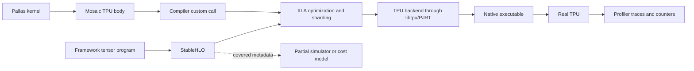

# TPU literature findings: compiler, profiler, and simulator

Research date: 2026-11-17, America/Los_Angeles.

Repository baseline: `f67fb13`, branch `tpu`.

Status: source research and local API inspection; no simulator was executed or
qualified against AMORA's TPU7x instance during this study.

## Request

User request, verbatim:

```text
literature research on TPU (compiler, profiler, simulator) into .plan/ *-findings-*.md
```

## Findings that change the next decision

1. **SCALE-Sim TPU is a serious integration candidate, with limits.** The 2026
   paper adds TPU-grounded calibration, non-systolic latency models and a
   StableHLO frontend. The public `stablehlo` branch contains those components;
   the default branch is not an equivalent artifact. Its coefficients and
   compensation models target v4/v6e, not our TPU7x. [S2]
2. **There are other TPU-validated models.** PyTorchSim reports comparison with
   TPUv3 using its own RISC-V-based NPU compiler/ISA; COCOSSim reports v3 layer
   comparisons using systolic/vector state machines. These are useful models,
   but neither is a Google-native binary simulator. [S3], [S4]
3. **Do not reduce simulator accuracy to a headline R².** The inspected
   SCALE-Sim TPU preprint reports aggregate GEMM MAPE of 32.2% despite strong
   per-regime correlations. COCOSSim's 13% applies to complete layers, while
   individual operations average 17%. Different datasets and metrics prevent
   a numerical ranking of these tools. [S2], [S4]
4. **The public compiler boundary is IR, not the native ISA.** StableHLO, XLA
   transformations, sharding and Pallas lowering are inspectable; the October
   2026 TorchTPU primary description explicitly identifies the actual TPU ISA
   as proprietary and non-public. A Mosaic/PTX analogy does not make either
   StableHLO or Mosaic a native instruction listing. [C1], [C4], [C5]
5. **Profiling offers more than the current AMORA adapter consumes.** Explicit
   compute/synchronization trace modes, TC/SparseCore counter sampling, and
   power/thermal options are documented. But HLO Op Profile's displayed rates
   combine static compiler work counts with profiled durations; Memory Viewer
   is static, while Memory Profile is dynamic. [P1], [P2], [P3]
6. **Fix the measurement contract before calibrating.** Simulator cycles,
   profiled device events, inferred “device-busy” time, synchronized host
   completion and batched throughput are different quantities. Reusing a
   cycles-to-time coefficient across these boundaries would invalidate the
   comparison. [S2], [P1], [P4]

Recommended order: improve explicit trace/counter capture and provenance first;
then evaluate a pinned SCALE-Sim TPU adapter on a strictly covered workload
subset. Use PyTorchSim/COCOSSim as independent architectural comparisons, and
Timeloop/MAESTRO as analytical baselines. Keep every result's generation,
runtime, compiler realization, measurement domain and holdout scope explicit.

## Source selection and reproducibility

The core sources are primary papers, author-hosted papers, official project
documentation and source repositories. Secondary search results were discovery
aids, not evidence for hardware/model claims. Publication dates were checked
where material: SCALE-Sim TPU's CAL record is July 2026; its available arXiv
history contains only v1, dated 23 March 2026. TorchTPU's introduction is dated
20 October 2026. Live documentation is identified as documentation rather than
peer-reviewed literature. [S2], [C5]

Relevant paper sections and implementation files were read. The publisher's
PyTorchSim PDF endpoint returned 403; the author-hosted full paper and official
artifact metadata were accessible. Failed/stale source paths are recorded in
the research receipts rather than interpreted as proof that a feature is absent.

Downloaded sources, extracted text, publication records, repository trees and
SHA-256 receipts are local-only in `out/tpu_literature/20261117-1646/`. Main
receipts include `source-manifest.json`, `additional-source-manifest.json`,
`repository-snapshot-manifest.json`, `publication-artifact-checks.json`,
`stablehlo-implementation-manifest.json` and `local-api-inspection.json`.
Mutable-source findings below use these inspected snapshots:

| Project | Inspected revision | What was checked |
|---|---|---|
| SCALE-Sim `main` | `87fd03d4ab3ac800119fc88904440c6da420226b` | Repository tree and v4/v5e/v6e cycle-to-time functions. |
| SCALE-Sim `stablehlo` | `8050a0f964f6a02c48fba1b6a42bba2eca0b31e3` | StableHLO parser, calibration workflow, per-op model artifacts and whole-model compensation. |
| XProf `master` | `1a8a83bdfe802abe67ce4f20fbfb89612cf8ab9d` | Advanced options and HLO Op Profile semantics. |
| Shardy `main` | `9ff88debff65e93d8cc0a3514037b3d233a44e37` | Sharding representation, propagation/partitioning source inventory and project status. |
| UCSB OpenTPU | `ca5d381c93752a504e8de1fa10c9d51649853c70` | Its own ISA, functional/RTL simulation and explicit binary incompatibility. |

The `stablehlo_v6` branch exists, but its detailed tree request timed out. The
verified `stablehlo` snapshot already includes v6e artifacts; no additional
claim is made about the uninspected branch. No pickle model or simulator
container was loaded. PyTorchSim's versioned artifact is available, but its
roughly 6.87 GB split Docker image was not downloaded. [S3]

## Compiler findings

### Framework, IR and machine boundaries



The diagram represents boundaries, not one universal release-specific pass
order. Pallas custom calls can carry lower-level kernel bodies that a simple
StableHLO operator parser does not understand. High-level HLO graphs therefore
cannot be assumed to describe the final memory movement, fusion, tile schedule
or native instruction stream. [C1], [C4], [C5]

| Component | Capability supported by sources | Practical limit |
|---|---|---|
| XLA / StableHLO | Typed tensor semantics, optimization, fusion/layout decisions, portable serialization and compiler entry points. | IR compatibility is not native executable compatibility or a performance model. Preserve compiler options and the IR phase used. [C1] |
| GSPMD | Compiler-driven partitioning from sparse user annotations; communication is inserted to implement distributed tensor semantics. | The 2021 evaluation reaches TPUv3 systems; it does not establish today's partitioner choice or every generation's communication costs. [C2] |
| Shardy | Axis-based sharding representation, propagation, compiler APIs and partitioning infrastructure; lineage combines GSPMD and PartIR. | It is an evolving compiler component. Its docs still describe work-in-progress bindings; inspect the actual installed build rather than infer readiness from project names. [C3] |
| Pallas / Mosaic TPU | Explicit tile programs, HBM/VMEM/SMEM abstractions, DMA/semaphores, intra-device core programming and lower-level scheduling control. | Accepted operations/layouts are restricted; compiler transforms still intervene. A kernel's source schedule is not an observed native instruction schedule. [C4] |
| PyTorch/XLA / TorchTPU | Different PyTorch execution paths through the TPU compiler/runtime; TorchTPU adds native eager/compile integration and custom-kernel entry points. | Frontend, graph boundaries and kernel realization differ. “Runs PyTorch on TPU” does not specify the same executable or timing protocol as JAX. [C5] |

Local CPU-side inspection of the installed JAX 0.12.0.1 confirmed that
`jax_use_shardy_partitioner` defaults to true. That is an API/build observation,
not a trace of which pass handled every historical workload. It is sufficient
reason to record the active partitioner configuration in future experiments
rather than call every SPMD result “GSPMD.”

### What compiler cost-model papers establish

**Kaufman et al., MLSys 2021.** The learned model decomposes XLA programs into
kernel subgraphs and predicts runtime for tile-size selection and fusion.
It evaluates TPU v2/v3. Its additive program model assumes kernel runtimes are
sufficiently independent: no overlapping kernel execution or consequential
inter-kernel caching. This is an assumption to test for contemporary
multi-core, pipelined and fused workloads, not a universal TPU property. [C6]

The paper separates optimization-ranking metrics from runtime-regression
metrics. For fusion kernels of at least 5 microseconds, it reports 4.5 MAPE in
the random-split evaluation and 6.2 on a harder manual split; the TPUv3 result
is separately reported as 4.9 MAPE. For tile selection on the manual split, the
learned model's 6.3% error is worse than the analytical baseline's 2.3%.
Thus “learned beats analytical” is task/split dependent. These numbers do not
qualify an off-the-shelf model for TPU7x.

**TPUGraphs, NeurIPS 2023.** Labels pair an HLO graph and compiler configuration
with execution time on TPU v3. The layout collection has about 31 million
graph/configuration pairs; tile tuning has about 13 million kernel/configuration
pairs. Layout and tile are different prediction problems. Compilation choices
are causal inputs to latency, so benchmarking a graph without its configuration
is incomplete. This is a dataset for learned cost models, not a cycle simulator
or a TPU7x timing oracle. Preserve graph-level holdouts and avoid treating many
configurations of one graph as independent workload generalization. [C7]

## Profiler and instrumentation findings

### Capabilities and their evidence level

| Tool/feature | What it can provide | What it does not establish by itself |
|---|---|---|
| JAX profiler capture / XProf Trace Viewer | Host threads, TPU chip/core timelines, operation durations and communication activity; XPlane and JSON/Perfetto outputs. | Full device coverage, isolated instruction latency, or non-overlapping event attribution. A device track's existence is not proof that every chip/core was traced. [P1], [P2] |
| Explicit TPU trace modes | `TRACE_ONLY_HOST`, `TRACE_ONLY_XLA`, `TRACE_COMPUTE`, `TRACE_COMPUTE_AND_SYNC`; sparse-core/chip scope options. | Default capture need not contain detailed compute/synchronization events. Availability is release/generation dependent. [P1], [P3] |
| Performance-counter options | `tpu_perf_counters`, periodic sampling and TC/SparseCore-family sampling options. | One universal metric vocabulary or a direct-counter interpretation for every UI number. Record counter definition, unit, resource scope, sampling interval and capture support. [P3] |
| Power/thermal options | Power trace levels and firmware throttle/power/thermal events are documented. | Device frequency control, exact energy attribution to one kernel, or unrestricted support on all TPU generations. [P3] |
| HLO Op Profile / Roofline | Op/module categories, durations, throughput, bandwidth and utilization/operational-intensity views. | Displayed TFLOP/s and GB/s are not necessarily raw hardware counter readings. HLO Op Profile explicitly combines compiler-estimated work with profiled durations. [P2] |
| Memory Viewer / Memory Profile | Viewer: compiler-planned buffers/lifetimes and memory-space allocation. Profile: dynamic runtime allocation information. | Static planned peak, dynamic allocator peak and physically available HBM are not interchangeable. TPU memory spaces exposed vary by tool/release. [P2] |
| Named scopes / trace annotations / Pallas `trace_value` | Correlation labels; `trace_value` attaches a dynamic scalar i32/f32 to an enclosing XProf trace event. | A marker is not an instruction counter or hardware timestamp. Instrumentation can change generated code, overhead and buffering. [C4], [P1] |

The inspected JAX guide says the default TPU trace mode is `TRACE_ONLY_XLA`.
Explicit `TRACE_COMPUTE_AND_SYNC` is therefore the first candidate for detailed
DMA/compute/semaphore studies, followed by support/overhead validation. Do not
retrospectively claim that AMORA's already captured default profiles include
every low-level resource event.

The XProf HLO Op Profile documentation is explicit: work-rate numerators come
from static compiler FLOP/byte information and denominators from profiled op
durations; utilization divides those rates by peak resource specifications.
Keep these as tool-derived quantities. Actual sampled hardware counters have
their own capture paths and semantics. Roofline's HBM/VMEM/CMEM views are
diagnostic models; the inspected page identifies CMEM support specifically for
TPU v4, so missing chart lines do not automatically prove a missing memory level.

XProf's project README also documents an operational limitation: some charts
depend on loading Google Charts over the Internet. Offline/corporate-network
rendering can be incomplete even when the underlying profile files are valid.

### Timestamp and scope rules

The public XPlane schema defines `XLine.timestamp_ns` in nanoseconds and
`XEvent.offset_ps` / `duration_ps` in picoseconds. An aggregated event can use
`num_occurrences` instead of a timestamp offset. Nested events are permitted.
These are time quantities, not native cycle counts. [P4]

For a non-aggregated event, schema-level conversion is:

```text
start_ns = line.timestamp_ns + event.offset_ps / 1000
duration_ns = event.duration_ps / 1000
```

This conversion alone does not validate the event's semantics. Identify the
subject executable, repeated instance, device/core and event category first.
Do not sum a fusion parent and its children, or parallel core/DMA durations,
as one elapsed program interval. Profiled and unprofiled lanes must preserve
the same source/IR/input identity and report instrumentation overhead separately.

The installed JAX 0.12.0.1 exposes `profiler_options` on `trace`/`start_trace`,
and CPU-side inspection accepted `ProfileOptions.advanced_configuration`.
The following is a version-checked API pattern, **not a hardware-qualified
capture recipe from this literature task**:

```python
options = jax.profiler.ProfileOptions()
options.advanced_configuration = {
    "tpu_trace_mode": "TRACE_COMPUTE_AND_SYNC",
    "tpu_perf_counters": True,
}
with jax.profiler.trace(output_dir, profiler_options=options):
    outputs = compiled(*device_inputs)
    jax.block_until_ready(outputs)
```

## Simulator findings

### Comparison by modeled object

Numbers below are the authors' reported metrics on their own evaluation sets.
They are not head-to-head comparisons and were not reproduced in this study.

| Model | Modeled object / compiler interface | Evidence and principal boundary |
|---|---|---|
| SCALE-Sim v3, ISPASS 2025 | Systolic arrays; multicore partitioning, sparsity, layout, Ramulator memory and Accelergy energy integration; conventional topology/config inputs. | Cycle-accurate behavior of the configured model; the v3 paper alone is not production-TPU validation. [S1] |
| SCALE-Sim TPU, CAL/arXiv 2026 | v3 compute plus calibrated cycles-to-time, learned non-systolic models and StableHLO conversion; branch adds whole-model compensation. | Published v4 GEMM and project v4/v6e evidence; calibration and op coverage remain target-specific. It does not execute Google's native binaries. [S2] |
| PyTorchSim, MICRO 2025 | PyTorch 2 → custom MLIR/LLVM lowering → RISC-V-based NPU ISA/Spike/gem5, or compiler-generated tile-operation graph; BookSim/Ramulator2 shared resources. | Reports 11.5% MAE of runtime relative to TPUv3. Its custom compiler/ISA is a virtual NPU implementation, not the XLA TPU backend. [S3] |
| COCOSSim, ISPASS 2025 | Configurable systolic/vector state machines, scheduling, DRAMSim3 and Torch FX frontend/pattern matching; VCD state traces. | TPUv3 Stable Diffusion layer study: 13% average layer error, 17% individual-op error. Vector latency entries are tuned from measurements. [S4] |
| ONNXim, CAL 2024 | ONNX input; event-driven tile compute with detailed DRAM/NoC contention and multicore/tenancy. | 0.23% mean absolute error against Gemmini RTL; a TPUv4i-like evaluated configuration is not validation against a real Cloud TPU. [S5] |
| STONNE | Configurable spatial/flexible accelerator components; current code includes `OS_MESH` and `TPU_OS_DENSE`. | Original validation is MAERI/RTL-oriented. “TPU” configuration names do not imply current XLA/runtime/ISA compatibility. [S6] |
| Timeloop / Accelergy | Analytical architecture/mapping search and technology/action-based energy estimates. | Useful resource/reuse/capacity baseline; no full native instruction/event stream or production TPU firmware model. [S7] |
| MAESTRO, MICRO 2019 | Analytical dataflow directives, reuse/occupancy and performance/energy projections. | Fast design-space baseline; generated latency is model-dependent, not observed TPU cycles. [S8] |
| ASTRA-Sim | Distributed workload/execution/network co-design; multiple network backends. | Useful ICI/DCN/topology experiments after compute/collective service contracts are supplied; not a full TPU-core implementation. [S9] |
| UCSB OpenTPU / TPTPU-Sim | Legacy v1-inspired own ISA/RTL or systolic-memory toy models. | OpenTPU explicitly says it is not binary compatible; TPTPU README calls v1 complete and v2 incomplete. Neither establishes modern TPU7x fidelity. [S10] |

### SCALE-Sim TPU: calibration, artifact and coverage details

The inspected preprint configures a 128×128 mesh and sweeps small/medium/large
GEMM regimes. It states that its target label excludes HBM-to-core transfers.
That statement must be verified against the actual event selection: a profiled
fusion span can still include memory movement and waits. It is already a
different contract from AMORA's synchronized host completion interval.

Its model is `t_hat = alpha * simulated_cycles + beta`. Per-regime fits report
R² from about 0.79 to above 0.97; the aggregate evaluation separately reports
R²=0.893 and MAPE=32.2%. Addition/ReLU learned models report median relative
errors 1.78%/2.55%. Do not replace these distinct results with the tutorial's
“up to R²=0.99” headline. The latter is a project/tutorial claim, not a guarantee
for the aggregate preprint evaluation or TPU7x.

The pinned `main` source has v4/v5e/v6e piecewise affine functions and no v7x
fit. For example, v6e's large-regime coefficient is 0.000040 microseconds per
simulated cycle. Its reciprocal must not be interpreted as a 25 GHz hardware
clock: it is an empirical mapping from an abstract simulator's cycles. Some
fits have negative intercepts; validate admissible shape domains and reject
nonphysical predictions rather than silently extrapolate. [S2-code]

The pinned `stablehlo` branch materially exceeds the preprint's narrow op list:
it includes parser/converter modules, many v4/v6e operator models, sample MLIR
graphs and calibration data. Its calibration is layered: array cycles →
per-op time → batched-op reduction → whole-model compensation, plus non-compute
models. The calibration README explicitly transfers the structure and
recalibrates the numbers on each target. [S2-branch]

Important implementation caveats:

- The calibration guide reuses a 128-based tile-fold selector for v6e. That
  may be a useful abstract predictor, but it is not evidence of v6e's actual
  256×256 MXU geometry or a cycle-faithful current-generation machine.
- Whole-model compensation coefficients account for fusion survival and fixed
  costs; source comments acknowledge collinearity and non-identifiability of
  some terms. Positive bounds on a fit do not turn coefficients into measured
  physical resource parameters.
- `measure_truth.py` computes “device_busy” from the difference of median host
  timings with and without `wait_device_ops`, clipped at zero. Treat that as
  coupled inference; it is not a directly timestamped device interval.
- The branch notes reshape can be either metadata-only or expensive relayout,
  and uses a median replacement after poor shape-only prediction. Shape alone
  is insufficient to identify layout/fusion/realization-dependent cost.
- The branch source comments report v6e whole-model in-sample MAPE 12.1% and
  leave-one-model-out 17.7% for a small LLM calibration set. These are source-
  reported results, not independent reproduction or a universal accuracy claim.
- The parser records `custom_call` metadata. That does not supply Pallas/Mosaic
  kernel-body semantics, arbitrary vector/carry/atomic behavior or collectives.
  An importer must account for every op or explicitly reject uncovered work.

This makes SCALE-Sim TPU a **hybrid predictive toolchain**, not simply a
faithful hardware cycle model. Pin the branch, calibration, coverage and event
selection together before using its output as simulator evidence.

### Compiler-integrated alternatives and legacy models

PyTorchSim's primary paper profiles real TPUv3 kernels via TensorFlow/XLA and
whole models through PyTorch/torch_xla. It compares a separately compiled
virtual NPU: Spike provides functional execution, gem5 instruction-level
timing, and tile-level simulation reuses offline operation latencies while
shared resources retain detailed models. Accuracy depends on both architecture
and compiler/mapping differences. Its current README also distinguishes
model execution support from cycle modeling: some DeepSeek gate operations
are not cycle-modeled. [S3]

COCOSSim's vector/reduction/broadcast and operation-fusion support refutes an
overbroad interpretation of “no elementwise support” in a comparison table.
The relevant question is exact op/phase coverage and calibration. Its 13%/17%
numbers derive from selected Stable Diffusion layers/operations; small-latency
startup effects and profiler noise are acknowledged limitations. [S4]

UCSB OpenTPU provides both functional and PyRTL hardware simulation for its
own v1-inspired instructions. It explicitly documents missing operations and
binary incompatibility. TPTPU-Sim is another legacy toy-purpose project, with
incomplete v2 and external Ramulator/process overhead. Names containing “TPU”
do not establish a simulator for current Google devices. [S10]

## Cross-generation and AMORA implications

Use the v1 ISCA paper, v4 system paper and 2026 v2-to-Ironwood survey as
architecture anchors, not one uniform hardware contract. v1's int8
256×256/CISC inference design differs from BF16 training TPUs with vector
units, software-managed memories and later SparseCore/OCS facilities. Product
branches v5e/v5p and v6e also differ; numeric generation order is not a feature
predicate. [A1], [A2], [A3]

For each model/capture, record array geometry and count per TPU TensorCore,
physical cores per chip, logical-device/core mode, memory hierarchy, dtype,
compiler/runtime and collective topology. The 2026 survey's general discussion
of Megacore must not replace a runtime-specific mode check. AMORA's recorded
TPU7x instance exposes eight logical TensorCores on four chips. [R1]

| Existing AMORA boundary | Research implication |
|---|---|
| [Compiler artifacts](../amora/backends/tpu/compiler.py) retain StableHLO/optimized HLO | Add explicit pre/post-partition phase and lower-level custom-call body identity before simulator interchange. HLO hashes are not native ISA hashes. |
| [Profiler adapter](../amora/backends/tpu/profiling.py) captures traces but leaves device duration unset | This remains justified. Admit an explicit mode/scope, converter version and event-selection contract before emitting device-only time or direct-counter quantities. |
| [Measurement runner](../amora/backends/tpu/runner.py) drains all outputs and names host completion | Preserve this metric; collect matched trace/device labels rather than subtract guessed dispatch constants or reuse v4 core-only fits. |
| [Metric definitions](../amora/backends/tpu/metrics.py) separate logical rates from physical traffic | Keep that separation when importing XProf roofline/op statistics or simulator memory events. |
| [Native qualification](../reports/google_tpu/tpu7x/qualification-summary.md) admits specific TPU7x recipes | Correctness and reproducible timing do not validate an external simulator's accuracy or transfer old-generation coefficients. |
| Current GCoM adapter is CUDA-oriented | Do not relabel it as TPU simulation; any new simulator needs its own execution/mapping contract. |

Suggested next bounded study, without changing today's accepted receipts:

1. Freeze a source/runtime/IR/operator-coverage matrix for the proposed adapter.
   Begin with aligned/tail GEMM and add/ReLU. Use gather, scatter/scan,
   collectives and opaque Pallas custom calls as fail-closed negative controls.
2. Admit `TRACE_COMPUTE_AND_SYNC` and selected counters on the current TPU7x.
   Validate event units, identity, resource scope, nesting and instrumentation
   overhead using separate matched profiled/unprofiled lanes.
3. Evaluate pinned SCALE-Sim TPU calibration on a held-out shape set with new
   TPU7x data. Report absolute error, median/tail relative error and regime
   coverage; keep any correction fit separate from identifiable hardware facts.
4. Compare with PyTorchSim/COCOSSim on common covered operators while recording
   frontend/compiler differences. Use Timeloop/MAESTRO for resource bounds and
   ASTRA-Sim only after compute/communication service costs are grounded.
5. Treat a generation transfer, dtype change, compiler update, core mode or
   fusion/layout change as a new validation row. This research does not locate
   or qualify a public native-binary-compatible TPU7x timing simulator.

## References

Paper versions and actual inspection scope are included to avoid mixing
preprint, project/tutorial, and current source claims.

| ID | Primary source | Inspection scope |
|---|---|---|
| A1 | Jouppi et al., *In-Datacenter Performance Analysis of a Tensor Processing Unit*, ISCA 2017. | Architecture paper PDF. |
| A2 | Jouppi et al., *TPU v4: An Optically Reconfigurable Supercomputer for Machine Learning with Hardware Support for Embeddings*, ISCA 2023. | System paper PDF. |
| A3 | Jouppi, Lakshmanamurthy, Young, Patterson, *Google's Training Supercomputers from TPU v2 to Ironwood*, 2026. | Author arXiv survey; states IEEE Micro July/August 2026 publication. |
| C1 | OpenXLA and StableHLO official documentation/specification; [XLA project](https://github.com/openxla/xla). | Current project source/docs; semantics and IR boundaries. |
| C2 | Xu et al., *GSPMD: General and Scalable Parallelization for ML Computation Graphs*, 2021. | arXiv technical paper. |
| C3 | OpenXLA Shardy project/docs. | Pinned repository inventory and docs; local JAX flag inspection. |
| C4 | JAX Pallas TPU details/core-map/lowering/primitives; [scalar trace source](https://github.com/jax-ml/jax/blob/main/jax/_src/pallas/mosaic/primitives.py). | Official source/docs; scalar trace API and scheduling/memory constraints. |
| C5 | PyTorch, *Introducing TorchTPU*, 20 October 2026. | Primary project architecture description and native ISA visibility statement. |
| C6 | Kaufman et al., *A Learned Performance Model for Tensor Processing Units*, MLSys 2021. | Final proceedings PDF; assumptions, metrics and split results. |
| C7 | Phothilimthana et al., *TpuGraphs*, NeurIPS 2023 Datasets and Benchmarks. | Proceedings PDF; TPUv3 labels/layout/tile collections. |
| P1 | JAX, *Benchmarking and profiling*. | Capture modes, synchronization and options; JAX 0.12.0.1 API inspection. |
| P2 | XProf tools: [Trace Viewer](https://openxla.org/xprof/trace_viewer), HLO Op Profile, [Roofline](https://openxla.org/xprof/roofline_model), [Memory Viewer](https://openxla.org/xprof/memory_viewer). | Official docs plus pinned HLO Op Profile source; static/runtime distinction. |
| P3 | XProf advanced profiler options. | Pinned source: counters, scope and firmware/power options. |
| P4 | XPlane protobuf schema. | Public source: units, aggregated/nested events. |
| S1 | Raj et al., *SCALE-Sim v3*, ISPASS 2025 / arXiv 2504.15377v1. | Paper and current source/project feature inventory. |
| S2 | Dang et al., *SCALE-Sim TPU*, CAL 2026, DOI 10.1109/LCA.2026.3724136. | arXiv 2603.22535v1; journal record confirmed, final journal PDF not inspected. |
| S2-code | SCALE-Sim `main` cycle-to-time functions. | Exact source revision and model coefficients. |
| S2-branch | SCALE-Sim `stablehlo` importer and calibration implementation. | Exact branch revision; source-reported compensation results distinguished from paper metrics. |
| S3 | Yang et al., *PyTorchSim*, MICRO 2025, DOI 10.1145/3725843.3756045; [project](https://github.com/PSAL-POSTECH/PyTorchSim), [versioned artifact](https://zenodo.org/records/16419768). | Author full paper, current README and Zenodo 1.0.0 artifact metadata. |
| S4 | Choudhary et al., *COCOSSim*, ISPASS 2025; [code artifact](https://doi.org/10.6084/m9.figshare.28614851). | Author full paper; phase model, tuned latencies and separate operation/layer errors. |
| S5 | Ham et al., *ONNXim*, CAL 2024 / arXiv 2406.08051v1. | Full paper; Gemmini RTL validation and shared-resource model. |
| S6 | Muñoz-Martínez et al., *STONNE*, arXiv 2006.07137; current STONNE project. | Paper abstract and project source; TPU-style mesh and MAERI-oriented validation. |
| S7 | Parashar et al., *Timeloop*, ISPASS 2019; Accelergy project. | Author paper/source; analytical mapping/energy role. |
| S8 | Kwon et al., *Understanding Reuse, Performance, and Hardware Cost of DNN Dataflows*, MICRO 2019. | MAESTRO paper and project. |
| S9 | ASTRA-Sim project. | Official source README and supported system/network modeling role. |
| S10 | UCSB ArchLab OpenTPU and [TPTPU-Sim](https://github.com/jinhachung/tptpu-sim) projects. | Source READMEs, simulation/ISA/binary-compatibility limitations. |
| R1 | AMORA's existing TPU7x qualification receipt. | Repo-local context only; no new native measurement in this study. |

[A1]: https://arxiv.org/abs/1704.04760
[A2]: https://arxiv.org/abs/2304.01433
[A3]: https://arxiv.org/abs/2606.15870
[C1]: https://openxla.org/stablehlo/spec
[C2]: https://arxiv.org/abs/2105.04663
[C3]: https://openxla.org/shardy
[C4]: https://docs.jax.dev/en/latest/pallas/tpu/details.html
[C5]: https://pytorch.org/blog/introducing-torchtpu/
[C6]: https://proceedings.mlsys.org/paper_files/paper/2021/file/6bcfac823d40046dca25ef6d6d59cc3f-Paper.pdf
[C7]: https://papers.neurips.cc/paper_files/paper/2023/file/ded1a89e2b3b925444ada973af66336e-Paper-Datasets_and_Benchmarks.pdf
[P1]: https://docs.jax.dev/en/latest/201/profiling.html
[P2]: https://openxla.org/xprof/hlo_op_profile
[P3]: https://github.com/openxla/xprof/blob/1a8a83bdfe802abe67ce4f20fbfb89612cf8ab9d/docs/advanced_profiler_options.md
[P4]: https://github.com/openxla/xla/blob/main/third_party/tsl/tsl/profiler/protobuf/xplane.proto
[S1]: https://arxiv.org/html/2504.15377v1
[S2]: https://arxiv.org/html/2603.22535v1
[S2-code]: https://github.com/scalesim-project/SCALE-Sim/blob/87fd03d4ab3ac800119fc88904440c6da420226b/scalesim/linear_model/tpu.py
[S2-branch]: https://github.com/scalesim-project/SCALE-Sim/tree/8050a0f964f6a02c48fba1b6a42bba2eca0b31e3/scalesim/latency_model
[S3]: https://jongse-park.github.io/files/paper/2025-micro-pytorchsim.pdf
[S4]: https://users.cs.duke.edu/~lkw34/papers/choudhary-cocossim-ispass2025.pdf
[S5]: https://arxiv.org/abs/2406.08051
[S6]: https://github.com/stonne-simulator/stonne
[S7]: https://parashar.org/ispass19.pdf
[S8]: https://arxiv.org/abs/1805.02566
[S9]: https://github.com/astra-sim/astra-sim
[S10]: https://github.com/UCSBarchlab/OpenTPU/tree/ca5d381c93752a504e8de1fa10c9d51649853c70
[R1]: ../reports/google_tpu/tpu7x/qualification-summary.md

## Revision History

| Revision | Research date | Source inputs and scope |
|---|---|---|
| r1 | 2026-11-17 | Preserved the request; surveyed primary architecture/compiler/profiler/model papers and pinned public implementations; cross-checked validation metrics, source/API limits and calibration protocols. Recorded AMORA implications separately from source claims. No simulator run, new native qualification, implementation change, commit or push was performed. |
